# Deskmates

Pixel puppets that float over your Mac desktop, like the old Office paperclip, and act out what your coding agents are doing: one puppet per busy session. Works with Claude Code, Codex and Cursor's command-line agent.

| When the agent is... | The puppet... |
| --- | --- |
| reading your prompt | rests its chin on its paw, with a thought bubble |
| working | types on its laptop and shoots an invader on its monitor with every tool call, or watches green Matrix rain pour faster with each one; now and then it turns to smile at you |
| reading or searching files | moves a magnifying glass over the monitor |
| running tests | shows a progress bar, then a green ✓ or a red ✗ |
| running subagents | plays ping pong: two puppets, one per subagent, each named after its task and scoring its own tool calls |
| asking you something or showing a plan | shows a question mark: "I have a question for you", "Plan ready for you" |
| waiting for a permission | holds up a sign with the tool's name: "May I use Bash?" |
| done | says the first sentence of the agent's answer, like "Fixed the parser and added two tests. ✓" |
| between turns | rests at its desk with the monitor off, and dozes off after a while |

## Agents

| Agent | Creature | What it shows |
| --- | --- | --- |
| Claude Code | the puppet | every mood above, and its plan: progress on the puppet and a card to read it |
| Codex | an owl, in teal | every mood above except two: no notifications, and no question (plans only). Its permission sign follows Codex's permission requests, but its default sandbox has not asked for one in our tries, so you may never see it. The owl leaves a few seconds after you quit Codex, in any terminal |
| Cursor CLI (`agent`) | a rabbit, in lavender | every mood above except three: no notifications, no question, and no permission sign (Cursor's hooks are not told when it asks you). A chat in the Cursor app gets a rabbit too, which waits at its desk until you quit Cursor; a click on it brings Cursor forward |

Codex and Cursor show the title each gives the session; Codex's subagents show their short task name, Cursor's their description. Want to add an agent, a creature or an animation? [CONTRIBUTING.md](CONTRIBUTING.md) has the steps.

## What it looks like

| | |
| --- | --- |
| 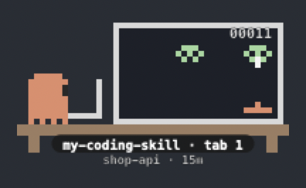 | **Coding.** It types on its laptop and shoots an invader on its monitor with every tool call. The tag says which command it runs and in which tab. |
| 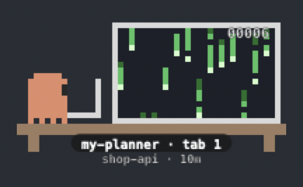 | **Matrix.** The same desk with green code rain, which pours faster with each tool call. |
| 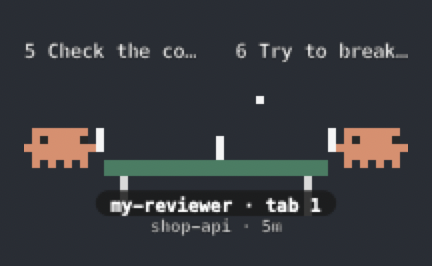 | **Ping pong.** One puppet per subagent, each scoring its own tool calls. |
| 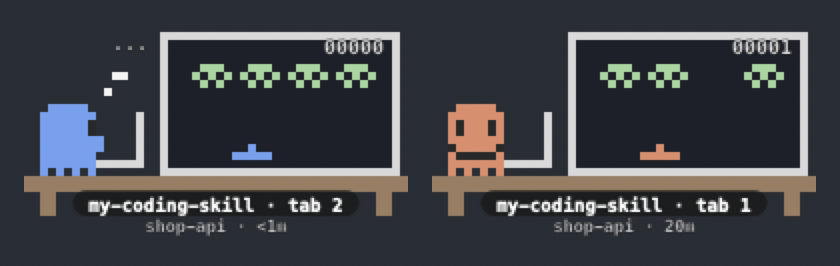 | **Thinking and smiling.** Left: reading your prompt, with a thought bubble. Right: now and then a working puppet turns to smile at you. |
| 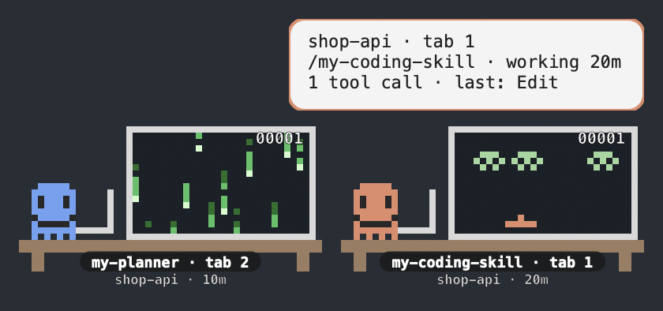 | **Happy.** The smile, on two puppets at once. |
| 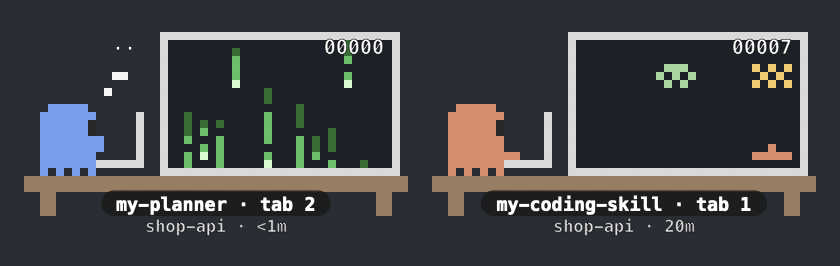 | **Side by side.** One tab codes while the other has just been given a prompt. |
| 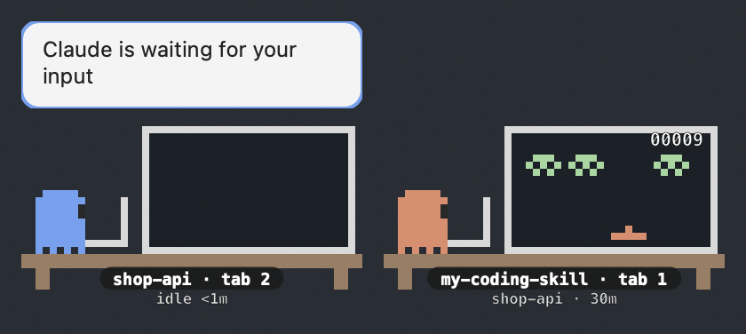 | **Waiting for you.** The agent's own notifications show in the bubble of the session they come from. |
| 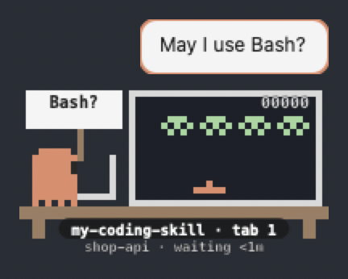 | **Waiting for a permission.** It holds up the tool's name and asks. |
| 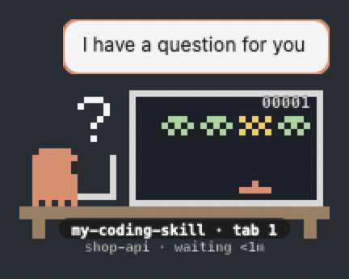 | **A question for you.** The agent asks something, or has a plan for you to read. |
| 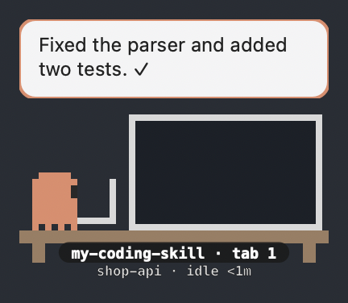 | **Done.** The bubble says the first sentence of the agent's answer. |
| 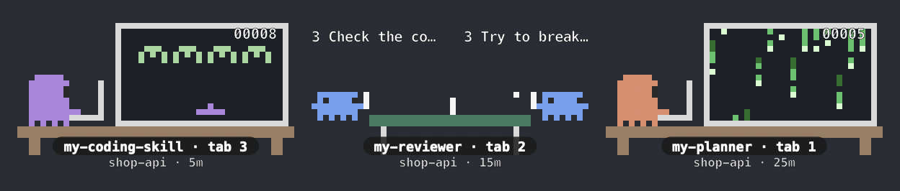 | **Several sessions.** One puppet per busy session, each in its own colour and scene. |
| 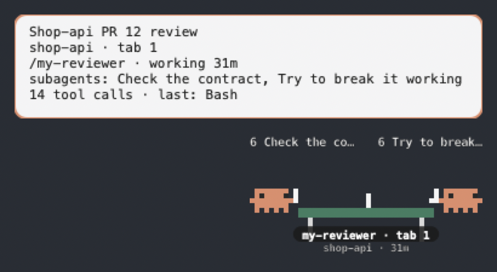 | **Where it is and what it does.** Rest the mouse on a puppet for its card. |
| 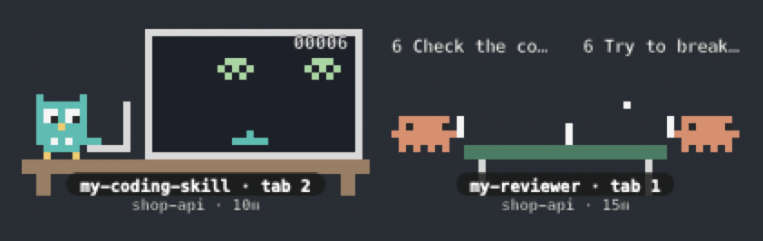 | **Three agents side by side.** Each agent has its own creature: the owl codes for Codex, the rabbit for Cursor, while Claude's subagents play ping pong. |
| 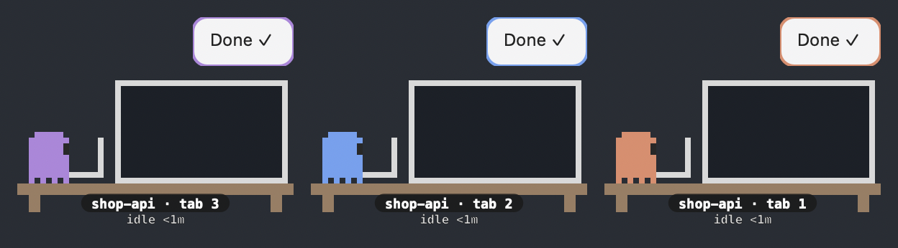 | **All done.** Each session says so above its own puppet. |
| 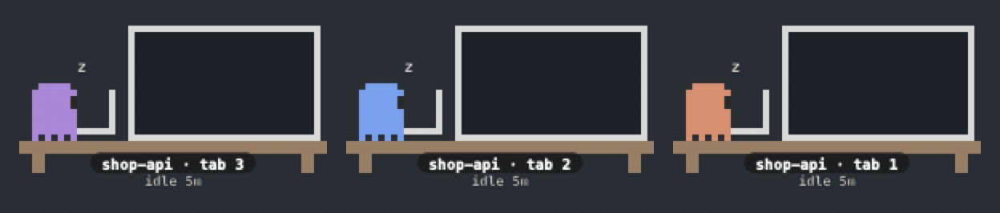 | **Between turns.** Each puppet rests at its desk, monitor off, and dozes off. |
| 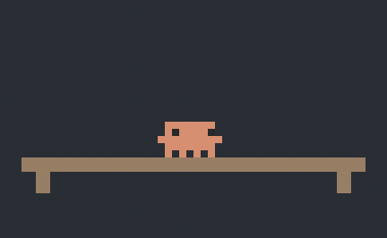 | **Nothing running.** One puppet waits at home. |

Each agent has its own creature and colours in the same scenes: the puppet for Claude Code, the owl for Codex, the rabbit for Cursor. A cat is drawn and waits for its agent.

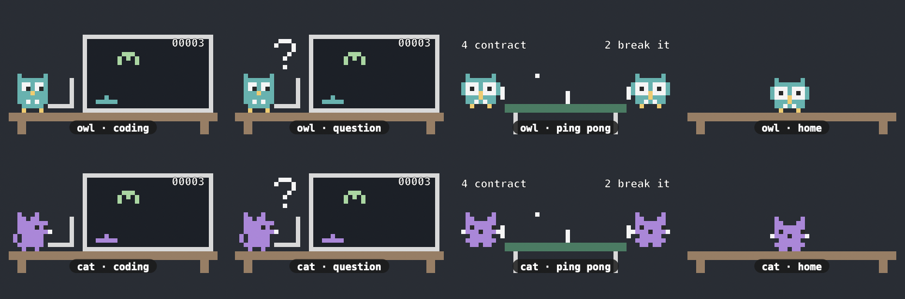

- **One puppet per session:** with one tab coding and another reviewing, two puppets sit side by side, each in its own colour, with a name tag (the command you ran, or the project folder), its own scene and its own bubble. Between turns a puppet rests at its desk with the monitor off, and dozes; it leaves when its session ends, when its terminal tab or window closes (in any terminal app), or, for Codex and Cursor, a few seconds after you quit the agent; a session with no terminal at all (run in the background) leaves once it rests. With no session on stage, one puppet waits at home.
- **Choose what plays** from the `▟▙` menu bar icon (or Option-click a puppet): list `my-coding-skill` under Coder, `my-planner` under Matrix and `my-reviewer` under Ping pong, and set the main conversation to Coder, Matrix, auto or Off. Each tab's puppet follows the command that tab runs.
- **See where each one is:** under the name tag, a short line gives the project folder and how long the puppet has been at it (`my-app · 32m`, `idle 12m`, `waiting 3m`). Rest the mouse on a puppet for a card with the rest: the session's title (as the agent names it), its folder and tab, the command and what it is doing, its subagents (by their task while working, and how many are done), its tool calls and the last tool, and the first sentence of its last reply.
- **Follow its plan:** when the agent works through a checklist, the line under its tag starts with its progress (`☑ 3/7`), the bubble says each step as it is done, and the card names the step it is on. Double-click a puppet whose agent made a plan to read it, in a card beside the puppet: the plan's title, summary and progress on top, its sections to jump to, the checklist beside the plan, and the files it touches and the endpoints it adds drawn as lists (each with its source a click away). Resize the card and it opens at that size next time; **Go to terminal** jumps there. Claude Code only, for now.
- **See what a session is working on:** when a session works on a ticket (a skill or subagent names one, like `ABC-12`, or the agent moves it in Jira), a double click opens the same card with the session on top: the ticket and its Jira status, a Plan → Dev → Review strip with when each phase started, how long the current one has run, and a ✓ when it finished (a subagent of that phase stopped, or you approved the plan), with the verdict when the reviewer wrote one (`Verdict: APPROVED`) (from the words in the skill's or subagent's name: `my-developer` is Dev, `my-reviewer` is Review), the latest reply, and a timeline of what happened. Click a phase to see only its lines; with more tickets, **Also** switches between them. Nothing leaves your Mac: only the ticket, phase words, status words and the replies' first sentences are kept, and only while the session runs. Claude Code only, for now.
- **Compare the plan with the work:** in a git repo, the same card shows what changed since the commit the repo was at when Deskmates first saw the session (marked "not by the agent" when no edit of the agent's named it, such as a write through a shell command), and below it what each turn did: its files, test runs and commits; for Claude Code, Codex and Cursor. For a Claude Code session with a plan, it puts the plan's files beside that, one row per file: `=` the same file, `←` planned and not changed yet, `→` changed and not in the plan, `?` an entry it cannot check.
- **Click a puppet** (or its bubble) to jump to the terminal running that session; a double click also opens its card, beside the terminal, where it stays until you close it. In iTerm2 it selects the exact window and tab, and the tab number is written under the puppet's table (`tab 3`, or `window 2 · tab 3` with several windows).
- **Drag any puppet** to move the whole row, across screens too; it stays on top of every app and every desktop. The `▟▙` menu bar icon sends the row to the corner of any screen, and puppets left on a screen you unplug come back to the main one.
- **Hide them** from the `▟▙` menu, or with ⌃⌥⌘P; they stay hidden until you show them again, even after a restart.

It is two small pieces: hooks that write one line per agent event to `~/.deskmates/events`, and a [Hammerspoon](https://www.hammerspoon.org) Spoon that reads them and draws the puppets. Nothing leaves your machine. From your prompts it keeps only a leading `/command` (never a path); from the agent's answers, only the first sentence; from the agent itself, the session's title, a subagent's short description, a skill's name and the agent's notifications; otherwise the tool names, the project folder's name and the terminal; never commands or code. The one exception is a plan: while Deskmates runs, the agent's checklist and plan are kept in `~/.deskmates/plans/` (readable by you only) for as long as the session lives, so the puppet can show them; they are deleted when the session ends.

## Install

**[INSTALL.md](INSTALL.md)** walks through it in about 5 minutes, on macOS 13 or later with Homebrew. What it changes on your Mac:

- installs Hammerspoon, a free macOS automation app (Homebrew);
- adds `~/.deskmates/` (the source and the events file) and links `~/.hammerspoon/Spoons/Deskmates.spoon` to it;
- adds three lines to `~/.hammerspoon/init.lua`;
- adds Deskmates' hooks to the settings of each agent it finds (`~/.claude/settings.json` for Claude Code, `~/.codex/hooks.json` for Codex, `~/.cursor/hooks.json` for Cursor), after saving a backup, keeping your other settings and hooks;
- asks you to allow Hammerspoon in **Accessibility** (to drag and click the puppets) and, with iTerm2, **Automation** (to show and select each session's tab), and to start it at login.

INSTALL.md also covers [choosing what plays](INSTALL.md#choose-what-plays), [updating](INSTALL.md#update) and [uninstalling](INSTALL.md#uninstall).

## More

Pairs with the in-terminal mods [puppet-ping-pong](https://github.com/cassiodias/claude-ping-pong) and [puppet-coder](https://github.com/cassiodias/claude-coder), but needs neither.

## License

MIT
